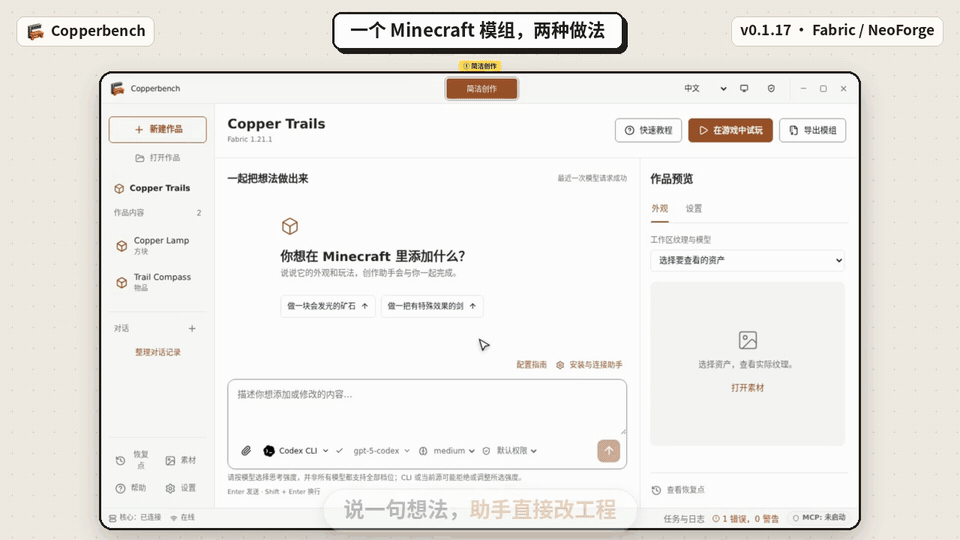
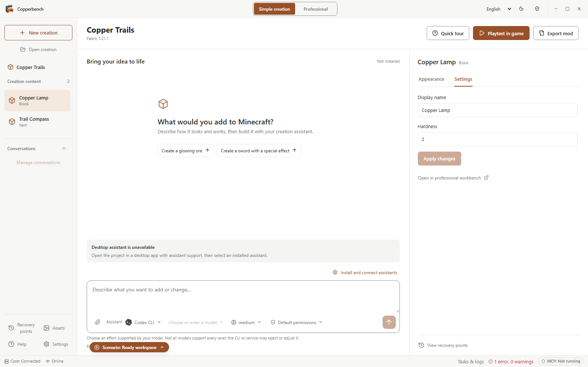
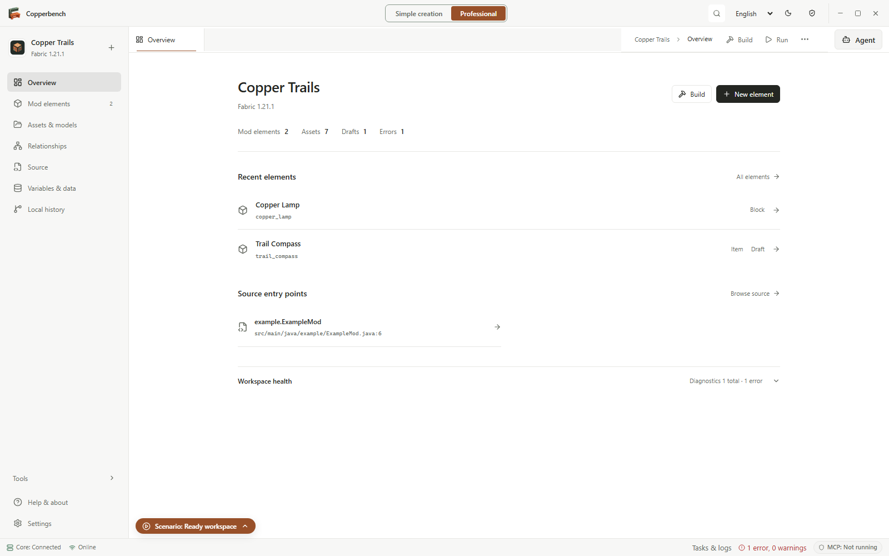
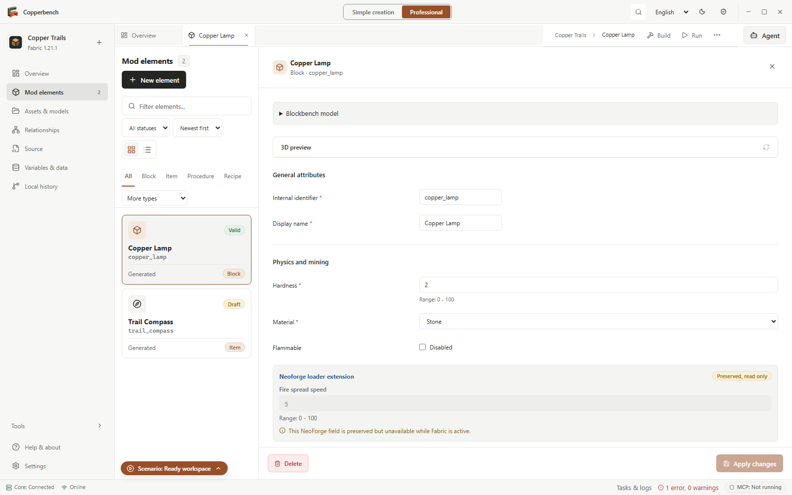
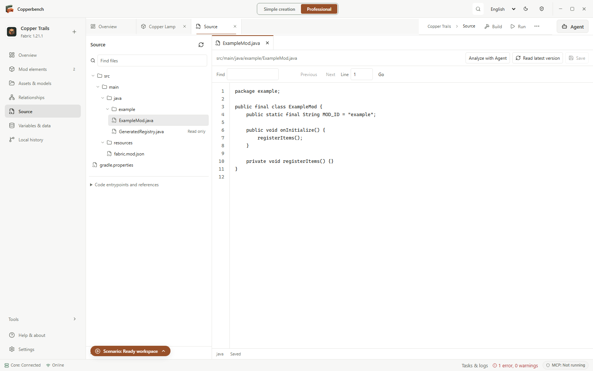
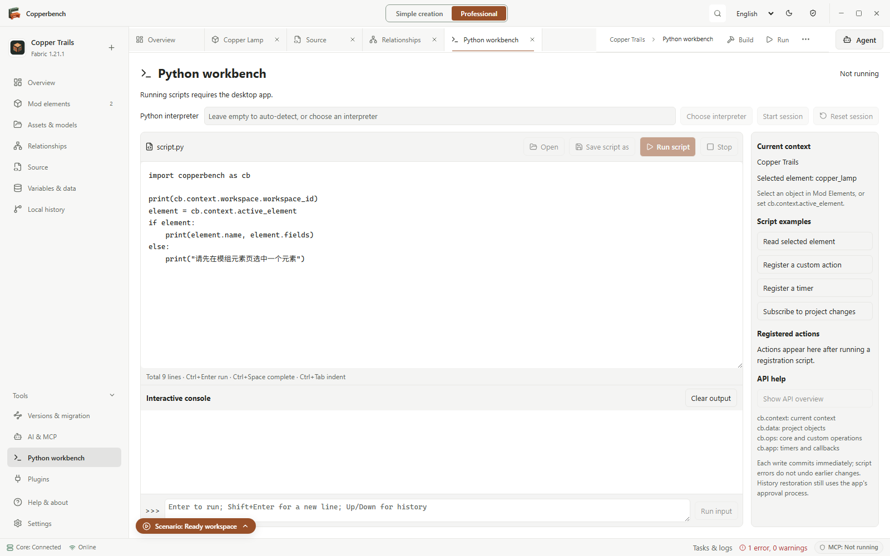
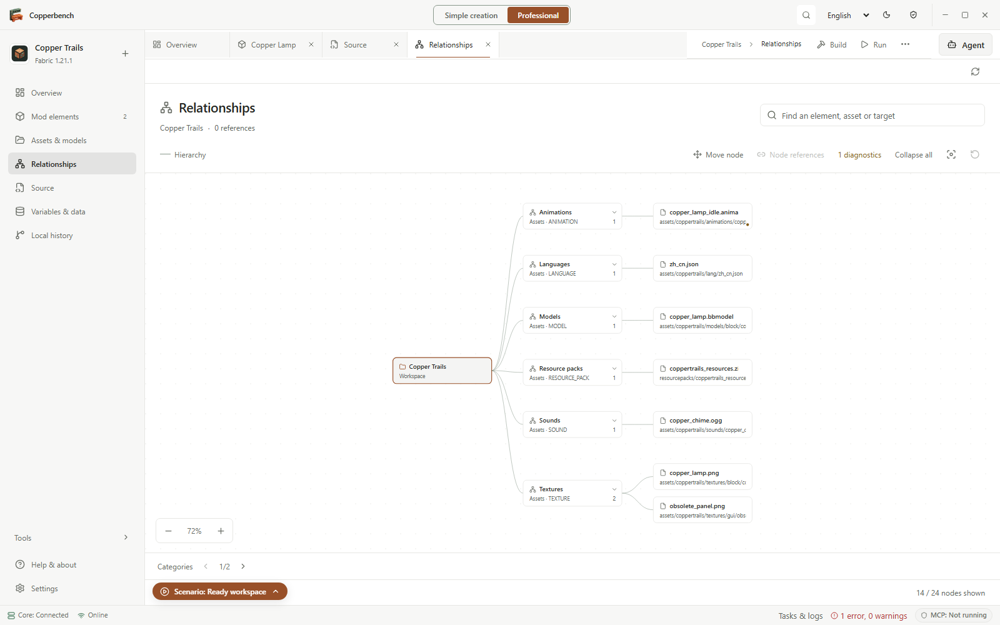

<div align="center">
  
  <h1>Copperbench</h1>
  <p><strong>Visual editing, manual Java and local Agent collaboration in one Minecraft mod project.</strong></p>

  <p><strong>English</strong> · <a href="README.zh-CN.md">简体中文</a></p>
  <p>
    <a href="https://github.com/Lotulune/Copperbench/actions/workflows/test.yml"></a>
    <a href="docs/releases/current.md"></a>
    <a href="docs/user/README.md"></a>
    <a href="#development"></a>
    <a href="LICENSE.txt"></a>
  </p>
  <p><a href="docs/releases/current.md">Download</a> · <a href="docs/README.md">Documentation</a> · <a href="#development">Run from source</a></p>
</div>

<p align="center">
  
</p>

Start in [Simple creation](docs/user/simple-creation.en.md) for a guided conversation workflow, or use the [manual Professional route](docs/user/first-creation.en.md).


Copperbench is a desktop workbench built on MCreator, with Fabric and NeoForge support. Start a block in the visual editor, extend behavior in manual Java, then let an external Agent inspect the same workspace, repair a build and return a reviewable artifact through a local session. Revisions, source hashes and generated/manual ownership protect the handoff between these steps.

**Current stable releases: Windows 0.1.18 and Linux 0.1.18.** This release adds static model and element previews, the professional Agent workflow, and fixes for Blockbench responsiveness and saved-model synchronization. See [current downloads](docs/releases/current.md) for packages and verification records.

Source identity, package hashes and verification scope are recorded separately for [Windows 0.1.18](docs/testing/maintenance-release-0.1.18.md) and [Linux 0.1.18](docs/testing/linux-publication-0.1.18.md).

<a id="getting-started"></a>

## Download and get started

| Platform | Current release | Packages | Guide |
| --- | --- | --- | --- |
| Windows 11 x64 | [0.1.18](https://github.com/Lotulune/Copperbench/releases/tag/v0.1.18) | EXE · Portable ZIP · MSIX · In-app update components | [Quick start](docs/user/getting-started.en.md) |
| Ubuntu 24.04 LTS x86_64 | [0.1.18](https://github.com/Lotulune/Copperbench/releases/tag/v0.1.18-linux-stable) | Graphical Setup.tar.gz · Debian .deb · Portable .tar.gz · In-app update components | [Linux installation](docs/user/linux-installation.en.md) |

Release notes: [Windows 0.1.18](docs/releases/v0.1.18.md) · [Linux 0.1.18](docs/releases/v0.1.18-linux.md). For later updates, choose **Check for updates** in **Help & about**.

1. Download your platform's package and verify it against the attached checksum manifest.
2. Choose **New creation** in **Simple creation**, or switch to **Professional** for the manual editing tutorial. Choose a loader, Minecraft version and a new workspace directory.
3. Follow [your first creation](docs/user/first-creation.en.md), then [build recovery and export](docs/user/build-and-export.en.md). Confirm persistence by quitting Minecraft normally and starting a new client process to reopen the same world.

The workbench supports English and Simplified Chinese. Bundled Fabric / NeoForge generators cover Minecraft **26.2, 26.1.2, 1.21.1 and 1.20.1**; each workspace uses one active generator.

Additional bundled **26.3 preview** targets require explicit opt-in and expose bounded operation/field capabilities. See [current status](docs/status.md); this does not expand the published generator support claim.

Windows packages remain unsigned for Authenticode; first builds need network access. Blockbench and creation-assistant CLIs are installed and configured separately; the Python workbench needs Python 3.11 or later. [Current downloads](docs/releases/current.md) records source/asset verification and the installed/gameplay checks not repeated on final packages.

<a id="showcase"></a>

## Workbench

| Simple creation | Professional workbench |
| :---: | :---: |
|  |  |
| Project content, assistant conversation and common settings in one view. | Open editors, inspect project status, and build or run from the overview. |
| **Mod Element editing** | **Java source** |
|  |  |
| Browse elements and edit their fields in the inspector. | Browse, search and edit manual files; generated files carry a read-only label. |
| **Python workbench** | **Relationships** |
|  |  |
| Script editor, console and current workspace context. | Browse, search and locate workspace elements and assets by category. |

Captured on 2026-10-24 from this checkout's light-theme browser preview with bundled Copper Trails example data. [Source and capture instructions](assets/screenshots/README.md)

## What you can do

| Feature | In practice |
| --- | --- |
| Simple creation and Agent | Switch between Simple creation and the professional workbench, sharing assistant conversations. Current source integrates Codex CLI, Claude Code, Grok Build, Google Antigravity CLI and DeepSeek Harness. |
| Visual editors | Create blocks, items, entities and other Mod Elements; arrange logic with Blockly and follow field diagnostics to the relevant control. |
| Source and Python | Edit manual Java with draft and conflict protection; use the [Python workbench](docs/user/python-workbench.md) for scripts and a persistent console connected to the current workspace. Generated files remain read-only. |
| Assets and models | Inspect textures, static model geometry and element appearance; open models in Blockbench and synchronize saved changes. |
| Workspace tools | Browse relationships, edit variables/tags/translations, and review local history and migration previews. |
| Build and deliver | Build, launch a test client or server, follow diagnostics to source, and export a mod. Exact verified export binds the artifact to the selected acceptance record. |

See the [user guide](docs/user/README.md) for feature and generator coverage. Bedrock Add-ons are outside the current first-party Java editing scope.

## Documentation

- [User guide](docs/user/README.md) · [Downloads](docs/releases/current.md) · [Troubleshooting](docs/user/troubleshooting.md)
- [Simple creation](docs/user/simple-creation.en.md) · [Professional Agent（简体中文）](docs/user/professional-agent.md) · [Python workbench（简体中文）](docs/user/python-workbench.md)
- [Agent setup](docs/ai/getting-started.en.md) · [SDK](sdk/README.md)
- [Development setup](docs/build/development-setup.en.md) · [Contributing](CONTRIBUTING.md) · [Documentation index](docs/README.md)

<a id="development"></a>

## Run from source

Requires JDK 25 (JetBrains Runtime with JCEF for the native desktop app), Node.js 22, npm, and Git. Windows commands use PowerShell 7. Configure the relevant tools using the [development setup guide](docs/build/development-setup.en.md).

```powershell
git clone https://github.com/Lotulune/Copperbench.git
Set-Location Copperbench
npm ci --prefix ui-core
npm ci --prefix ui-shell
.\gradlew.bat runProductShell
```

On Linux, use `./gradlew runProductShell`. Builds use the Gradle Wrapper included in the repository.

## Credits and license

Copperbench is an independent derivative of MCreator, licensed under [GPL-3.0-only](LICENSE.txt). Thanks to Pylo and the [MCreator contributors](https://github.com/MCreator/MCreator/graphs/contributors). See [UPSTREAM.md](UPSTREAM.md) for the pinned upstream version and source records.

[Additional terms](LICENSE-ADDITIONAL-TERMS.md) retain the template exception, trademark terms, and Minecraft mappings notice. Third-party licenses and credits are in [license](license/) and [compliance](compliance/). MCreator is a trademark of Pylo; its names and logos are not licensed under the GPL.

**Not an official MCreator or Minecraft product. Not approved by or associated with Mojang or Microsoft.**
