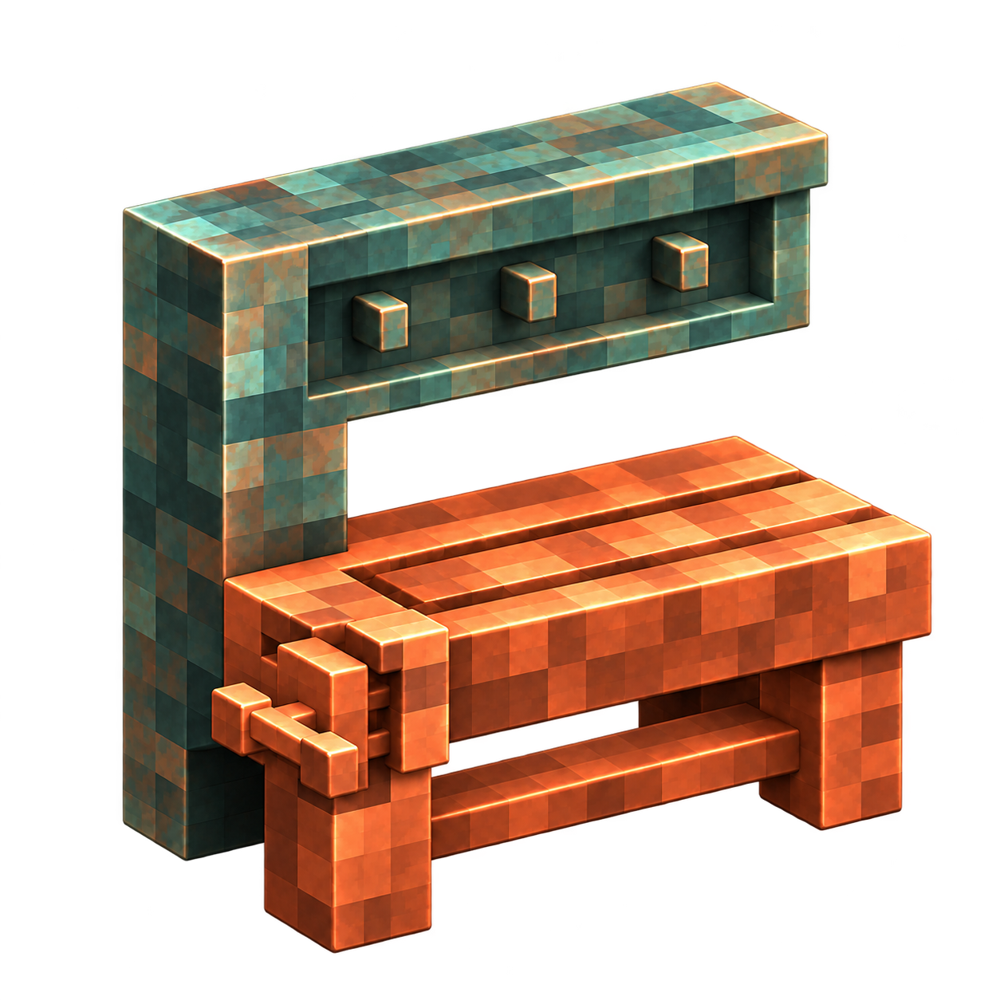
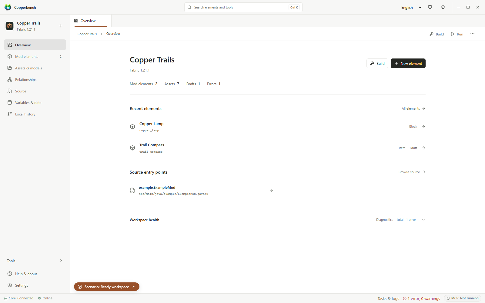
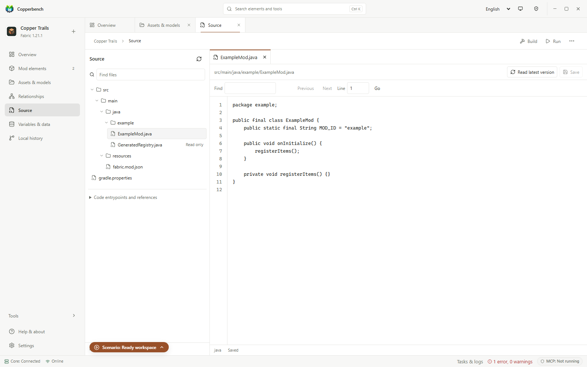
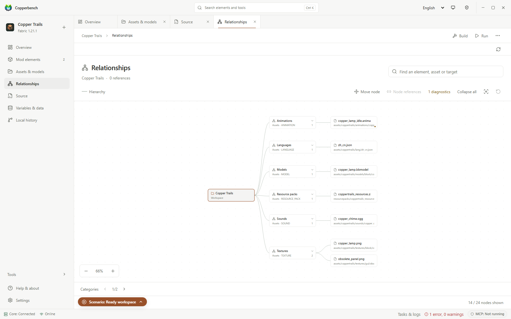

<div align="center">
  
  <h1>Copperbench</h1>
  <p><strong>Visual editing, manual Java and local Agent collaboration in one Minecraft mod project.</strong></p>
  <p><strong>English</strong> · <a href="README.zh-CN.md">简体中文</a></p>
  <p><a href="docs/releases/current.md">Download</a> · <a href="docs/README.md">Documentation</a> · <a href="#development">Run from source</a></p>
</div>

Copperbench is a desktop workbench built on MCreator, with Fabric and NeoForge support. Start a block in the visual editor, extend behavior in manual Java, then let an external Agent inspect the same workspace, repair a build and return a reviewable artifact through a local session. Revisions, source hashes and generated/manual ownership protect the handoff between these steps.

**Current stable releases: Windows 0.1.15 and Linux 0.1.15.** Switch between Simple creation with five host-installed CLI agents and the professional workbench. Draft protection, task/log navigation, dialog focus and native progress displays are improved. See [current downloads](docs/releases/current.md) for packages and verification records.

Source identity, package hashes and verification scope are recorded separately for [Windows 0.1.15](docs/testing/maintenance-release-0.1.15.md) and [Linux 0.1.15](docs/testing/linux-publication-0.1.15.md).

<a id="getting-started"></a>

## Download and get started

| Platform | Current release | Packages | Guide |
| --- | --- | --- | --- |
| Windows 11 x64 | [0.1.15](https://github.com/Lotulune/Copperbench/releases/tag/v0.1.15) | EXE · Portable ZIP · MSIX · In-app update components | [Quick start](docs/user/getting-started.en.md) |
| Ubuntu 24.04 LTS x86_64 | [0.1.15](https://github.com/Lotulune/Copperbench/releases/tag/v0.1.15-linux-stable) | Graphical Setup.tar.gz · Debian .deb · Portable .tar.gz · In-app update components | [Linux installation](docs/user/linux-installation.en.md) |

Release notes: [Windows 0.1.15](docs/releases/v0.1.15.md) · [Linux 0.1.15](docs/releases/v0.1.15-linux.md). For later updates, choose **Check for updates** in **Help & about**.

1. Download your platform's package and verify it against the attached checksum manifest.
2. Choose **New creation** in **Simple creation**, or switch to **Professional** for the manual editing tutorial. Choose a loader, Minecraft version and a new workspace directory.
3. Follow [your first creation](docs/user/first-creation.en.md), then [build recovery and export](docs/user/build-and-export.en.md). Confirm persistence by quitting Minecraft normally and starting a new client process to reopen the same world.

The workbench supports English and Simplified Chinese. Bundled Fabric / NeoForge generators cover Minecraft **26.2, 26.1.2, 1.21.1 and 1.20.1**; each workspace uses one active generator.

Additional bundled **26.3 preview** targets require explicit opt-in and expose bounded operation/field capabilities. See [current status](docs/status.md); this does not expand the published generator support claim.

Windows packages remain unsigned for Authenticode; first builds need network access and Blockbench is installed separately. [Current downloads](docs/releases/current.md) records source/asset verification and the installed/gameplay checks not repeated on final packages.

<a id="showcase"></a>

## Workbench



<table>
  <tr>
    <td width="50%"></td>
    <td width="50%"></td>
  </tr>
  <tr>
    <td><strong>Source</strong><br>File tree, search, editor tabs and read-only generated files.</td>
    <td><strong>Relationships</strong><br>Browse elements and assets, expand groups and locate related content.</td>
  </tr>
</table>

<sub>Browser captures of the 0.1.4 frontend with the bundled Copper Trails example data. [Current promotional images and capture details](assets/screenshots/README.md)</sub>

## What you can do

| One engineering workflow | In practice |
| --- | --- |
| Create visually | Save a Trail Block with its item and texture; inspect element and asset relationships. |
| Extend and collaborate | Open manual Java from Source, or connect an Agent to the same live workspace. Review field diagnostics and external-change conflicts before saving. Generated files remain read-only. |
| Repair and deliver | Follow a failed build's diagnostic to its source, rerun the affected task, confirm the behavior in Minecraft and export the artifact. Exact verified export uses the selected acceptance record's JAR/report hashes. |

See the [user guide](docs/user/README.md) for feature and generator coverage. Bedrock Add-ons are outside the current first-party Java editing scope.

## Documentation

The key installation, first-creation, build/export and Agent routes have paired English and Simplified Chinese pages with same-topic language links.

- [Documentation index](docs/README.md) · [First creation](docs/user/first-creation.en.md) · [Build recovery and export](docs/user/build-and-export.en.md)
- [Agent onboarding](docs/ai/getting-started.en.md) · [The same Trail Block through public APIs](docs/ai/trail-block.en.md) · [SDK](sdk/README.md)
- [Development setup](docs/build/development-setup.en.md) · [Contributing](CONTRIBUTING.md) · [Repository layout](docs/maintenance/repository-maintenance.md)
- [Current status: downloads, source, preview and unverified](docs/status.md) · [Tests and release records](docs/testing/README.md) · [Historical roadmap](docs/roadmap/README.md)

<a id="development"></a>

## Run from source

Requires JDK 25 (JetBrains Runtime with JCEF for the native desktop app), Node.js 22, npm, and Git. Windows commands use PowerShell 7. Configure the relevant tools using the [development setup guide](docs/build/development-setup.en.md).

```powershell
git clone https://github.com/Lotulune/Copperbench.git
Set-Location Copperbench
npm ci --prefix ui-core
npm ci --prefix ui-shell
.\gradlew.bat runProductShell
```

On Linux, use `./gradlew runProductShell`. Builds use the Gradle Wrapper included in the repository.

## Credits and license

Copperbench is an independent derivative of MCreator, licensed under [GPL-3.0-only](LICENSE.txt). Thanks to Pylo and the [MCreator contributors](https://github.com/MCreator/MCreator/graphs/contributors). See [UPSTREAM.md](UPSTREAM.md) for the pinned upstream version and source records.

[Additional terms](LICENSE-ADDITIONAL-TERMS.md) retain the template exception, trademark terms, and Minecraft mappings notice. Third-party licenses and credits are in [license](license/) and [compliance](compliance/). MCreator is a trademark of Pylo; its names and logos are not licensed under the GPL.

**Not an official MCreator or Minecraft product. Not approved by or associated with Mojang or Microsoft.**
