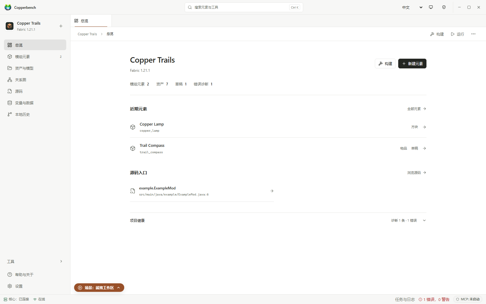
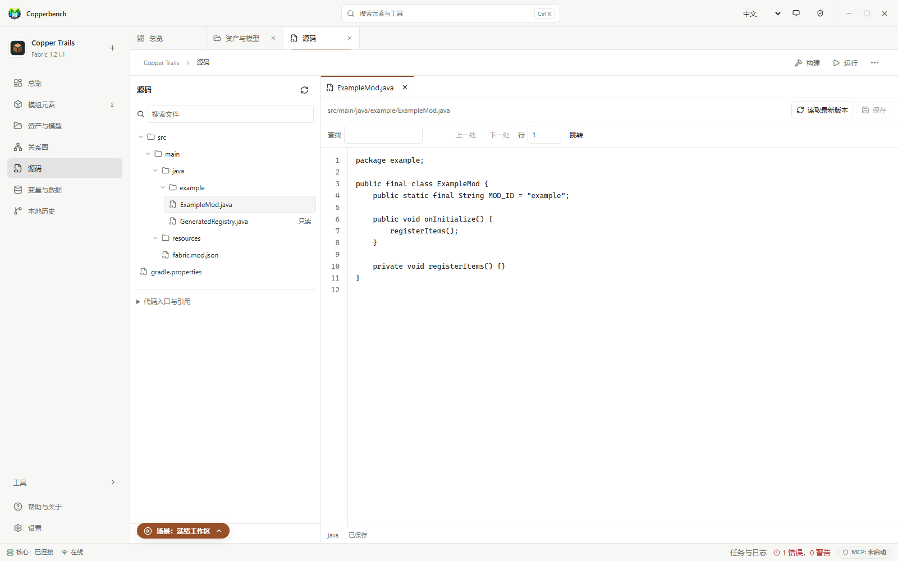
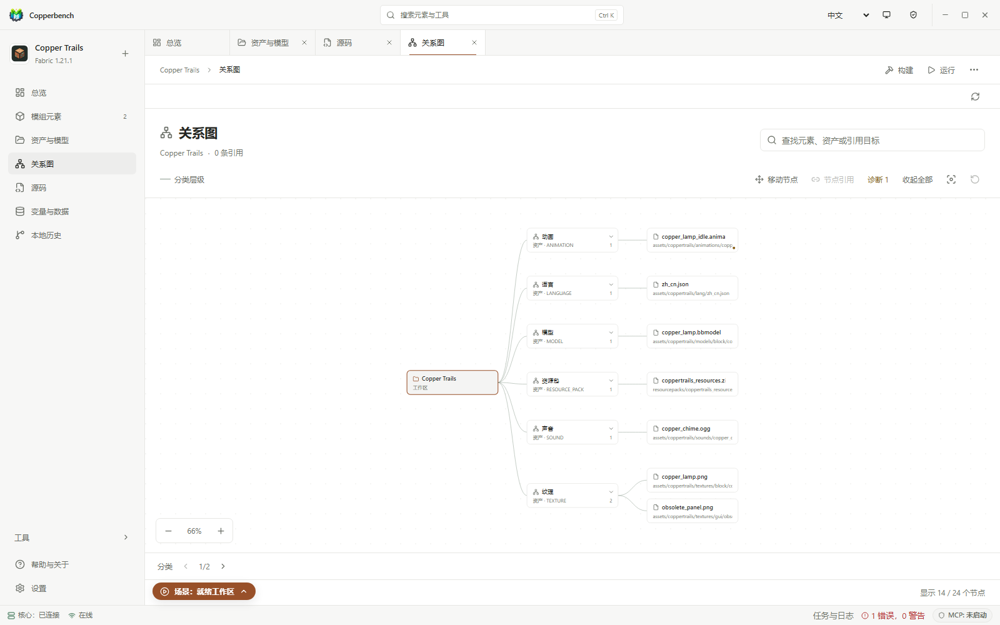

<div align="center">
  
  <h1>Copperbench</h1>
  <p><strong>让可视化编辑、手写 Java 和本地 Agent 在同一个 Minecraft 模组工程中协作。</strong></p>

  <p><a href="README.md">English</a> · <strong>简体中文</strong></p>
  <p>
    <a href="https://github.com/Lotulune/Copperbench/actions/workflows/test.yml"></a>
    <a href="docs/releases/current.md"></a>
    <a href="docs/user/README.md"></a>
    <a href="#development"></a>
    <a href="LICENSE.txt"></a>
  </p>
  <p><a href="docs/releases/current.md">下载</a> · <a href="docs/README.md">文档</a> · <a href="#development">源码运行</a></p>
</div>

普通玩家可从[简洁创作首作路线](docs/user/simple-creation.md)开始；也可使用[专业模式手动路线](docs/user/first-creation.md)。


Copperbench 是基于 MCreator 的桌面工作台，支持 Fabric 和 NeoForge。先用可视化编辑器创建方块，再用手写 Java 扩展行为，让外部 Agent 通过本机会话检查同一个工作区、修复构建并交付可审阅的产物。revision、源码 hash 和 generated/manual 归属保护各步骤间的修改。

**当前稳定版：Windows 0.1.15、Linux 0.1.15。** 新增简洁创作与专业工作台切换，接入五种本机 CLI 创作助手，并改善草稿保护、任务日志、弹窗焦点和原生进度显示。安装包和验证记录见[当前下载](docs/releases/current.md)。

源码身份、安装包哈希和验证范围分别记录在 [Windows 0.1.15 发布记录](docs/testing/maintenance-release-0.1.15.md)和 [Linux 0.1.15 发布记录](docs/testing/linux-publication-0.1.15.md)中。

<a id="getting-started"></a>

## 下载与开始使用

| 平台 | 当前版本 | 安装包 | 指南 |
| --- | --- | --- | --- |
| Windows 11 x64 | [0.1.15](https://github.com/Lotulune/Copperbench/releases/tag/v0.1.15) | EXE · 便携 ZIP · MSIX · 应用内更新组件 | [快速开始](docs/user/getting-started.md) |
| Ubuntu 24.04 LTS x86_64 | [0.1.15](https://github.com/Lotulune/Copperbench/releases/tag/v0.1.15-linux-stable) | 图形安装 Setup.tar.gz · Debian .deb · 便携 .tar.gz · 应用内更新组件 | [Linux 安装](docs/user/linux-installation.md) |

版本说明：[Windows 0.1.15](docs/releases/v0.1.15.md) · [Linux 0.1.15](docs/releases/v0.1.15-linux.md)。后续更新可在「帮助与关于」中选择「检查更新」。

1. 下载对应平台的安装包，用 Release 附带的校验文件核验。
2. 在「简洁创作」中点击「新建作品」，或切换「专业工作台」使用手动编辑教程；选择加载器、Minecraft 版本和新的工作区目录。
3. 按[第一件作品](docs/user/first-creation.md)创建方块，再看[构建失败与导出](docs/user/build-and-export.md)。持久化确认须正常退出 Minecraft，再启动新客户端进程，打开同一个世界。

工作台支持简体中文和英文。内置 Fabric / NeoForge 生成器覆盖 Minecraft **26.2、26.1.2、1.21.1、1.20.1**；一个工作区同时使用一个活动生成器。

另有需显式启用的 **26.3 预览**轨道，操作与字段范围以能力查询为准。见[当前状态](docs/status.md)，不扩大已发布生成器的支持声明。

Windows 安装包未做 Authenticode 签名，首次构建需要联网，Blockbench 单独安装。最终包的来源、资产核验及未重复的安装／玩法范围见[当前下载](docs/releases/current.md)。

<a id="showcase"></a>

## 工作台



<table>
  <tr>
    <td width="50%"></td>
    <td width="50%"></td>
  </tr>
  <tr>
    <td><strong>源码</strong><br>文件树、搜索、编辑标签页与生成文件只读标识。</td>
    <td><strong>关系图</strong><br>浏览元素与资产，展开分组并定位相关内容。</td>
  </tr>
</table>

<sub>0.1.4 前端的浏览器截图，使用内置 Copper Trails 示例数据。 [当前宣传素材与截图来源](assets/screenshots/README.md)</sub>

## 能做什么

| 一条工程工作流 | 用法 |
| --- | --- |
| 可视化创建 | 保存步道方块、方块物品和纹理，查看元素与资产的关系。 |
| 源码扩展与协作 | 从「源码」编辑手写 Java，或把 Agent 接到同一桌面工作区；保存前审阅字段诊断与外部修改冲突，生成文件保持只读。 |
| 修复与交付 | 从构建诊断定位源码，修复后重跑相关任务，在 Minecraft 确认行为并导出；精确已验证导出绑定所选验收任务的 JAR／报告 hash。 |

具体功能与生成器范围见[使用说明](docs/user/README.md)。Bedrock Add-on 不属于当前第一方 Java 模组编辑范围。

## 文档

- [文档导航](docs/README.md) · [第一件作品](docs/user/first-creation.md) · [构建失败与导出](docs/user/build-and-export.md)
- [Agent 接入](docs/ai/getting-started.md) · [用公开 API 创建同一个步道方块](docs/ai/trail-block.md) · [SDK](sdk/README.md)
- [开发环境](docs/build/development-setup.md) · [贡献指南](CONTRIBUTING.md) · [项目目录与维护](docs/maintenance/repository-maintenance.md)
- [当前状态：下载版／源码／预览／未验证](docs/status.md) · [测试与发布记录](docs/testing/README.md) · [历史路线](docs/roadmap/README.md)

<a id="development"></a>

## 从源码运行

需要 JDK 25（桌面运行推荐带 JCEF 的 JetBrains Runtime）、Node.js 22、npm 和 Git；Windows 命令使用 PowerShell 7。先按[开发环境说明](docs/build/development-setup.md)配置 JDK。

```powershell
git clone https://github.com/Lotulune/Copperbench.git
Set-Location Copperbench
npm ci --prefix ui-core
npm ci --prefix ui-shell
.\gradlew.bat runProductShell
```

Linux 使用 `./gradlew runProductShell`。构建使用仓库自带的 Gradle Wrapper。

## 来源与许可

Copperbench 是 MCreator 的独立衍生项目，采用 [GPL-3.0-only](LICENSE.txt)。感谢 Pylo 和 [MCreator 贡献者](https://github.com/MCreator/MCreator/graphs/contributors)。上游版本与来源记录见 [UPSTREAM.md](UPSTREAM.md)。

[附加许可条款](LICENSE-ADDITIONAL-TERMS.md)保留了模板例外、商标及 Minecraft mappings 声明；第三方许可与致谢见 [license](license/) 和 [compliance](compliance/)。MCreator 是 Pylo 的商标，相关名称和标志不随 GPL 授权。

**本项目并非官方 MCreator 或 Minecraft 产品，未经 Mojang 或 Microsoft 批准，也与其无关联。**
